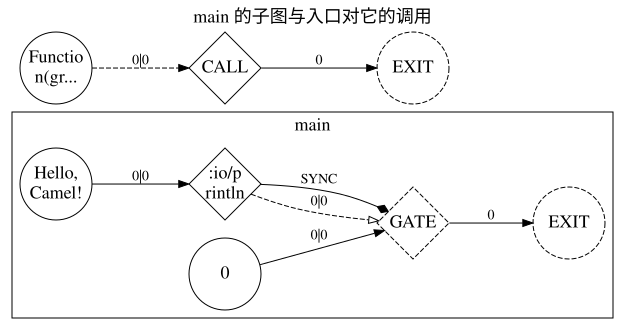
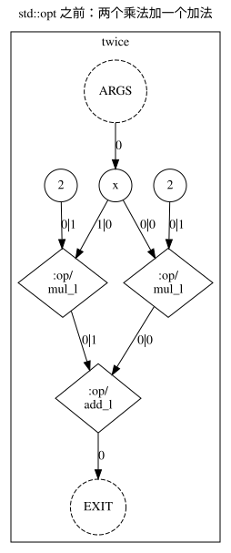
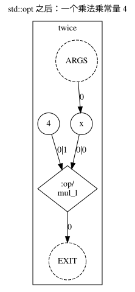

# Chapter 1 · Five minutes to see the graph

English | [中文](01_five_minutes.cn.md) · [Back to the contents](tutorial.en.md)

By the end of this chapter you will have run your first Camel program and seen two things other languages do not
show you: **your function is a graph**, and **the compiler rewrites that graph without changing the result**.
The question this book keeps asking starts here: **what is this code on the graph?**

## Why Camel

Most languages write a program as instructions for a machine to follow one after another. What a compiler, a
parallel runtime, automatic differentiation and a GPU backend actually need is a graph: what is to be computed, and
what depends on what. In other languages that graph can only be recovered from the code after the fact, and what
comes back is a broken graph that has lost the meaning of side effects. Camel makes **the program itself the
graph**: what you write is the computation and its dependencies, and the order is written only where it matters —
so the graph is not guessed at, and rewriting the graph is rewriting your program. Why the language puts AI first
is in [Why Camel](../why.en.md).

## Getting `camel` first

```bash
pip install camel-lang
camel --version
```

That puts `camel` on your `PATH`, and you are ready for the commands below. To work on the language itself, or to
follow the main line, the other road is building from source: [setup.en.md](../setup.en.md) (it builds into
`out/latest/bin`). The examples below live in the repository, and the commands run from its root.

## The first program

[`examples/01_hello.cml`](examples/01_hello.cml):

```cml
// The smallest program: `main` is the entry, and its body is a sync block.
// Run: camel docs/tutorial/examples/01_hello.cml

func main(): int sync {
    println('Hello, Camel!')
    return 0
}
```

```bash
camel docs/tutorial/examples/01_hello.cml
```

```text
Hello, Camel!
```

- One `.cml` file is one module, and `module hello` names it (the name may be left out).
- The program starts at `main`. The `int` it returns is the process exit code, so this one returns `0`.
- The **`sync`** after the return type says the body is a **sync block**: the statements written directly in it
  run in the order they are written. Why is it needed? Camel computes only the results that are **needed**, and
  "it printed" is a result nobody needs; `sync` makes this body run in the order it is written. The detail is
  chapter 10's; for now remember "a function that prints has `sync` in front of its body".
- A newline separates statements; no semicolons are needed.

## Your function is a graph

Put `std::rgir` at the end of the command line: the program does not run, and the compiler **draws** the graph it
built (DOT is Graphviz's format; hand it to `dot` and you have a picture). What you write after the file name is a
**pass**, and `std::rgir` is the pass that draws the graph.

```cml
// The smallest program: `main` is the entry, and its body is a sync block.
// Run: camel docs/tutorial/examples/01_hello.cml

func main(): int sync {
    println('Hello, Camel!')
    return 0
}
```

```bash
camel docs/tutorial/examples/01_hello.cml std::rgir > hello.dot
dot -Tsvg hello.dot -o hello.svg
```



Reading this against the source (circles are values, diamonds are operators or gates):

- The large box is the **subgraph of `main`**. There is no "what line 5 does" in a graph, only nodes and edges.
- The circle labelled `Hello, Camel!` is the string constant and the diamond labelled `:io/println` is the
  `println` operator; the **data edge** between them says "this string is its argument".
- The circle labelled `0` is the returned value and the diamond labelled `GATE` is the exit gate: `0` reaches the
  gate, and the gate's output is the value of `main`.
- The edge from `println` to `GATE` is a **sync edge** (`std::rgir` draws it dashed with an empty arrowhead):
  **a sync block is a sync edge between effects on the graph**. It puts `println` before the exit — that is, before
  `return 0` — which is exactly what `sync` does. Take `sync` away and neither the edge nor `println` is there
  (chapters 9 and 10).
- The pair of nodes below is the entry itself: the diamond labelled `CALL` is the entry calling `main`, and its
  input is the subgraph `main`.

Every picture in this book is drawn from an example by a script: [`tools/render-graphs.mjs`](tools/render-graphs.mjs).
What it draws goes into [`images/`](images/), and beside each picture is a `.dot` of the same name — the picture is
drawn from it. `node docs/tutorial/tools/render-graphs.mjs --check` draws them again and compares, so a picture
cannot drift away from the example it came from.

## The compiler rewrites the graph

The second program writes a little more than it needs: the same multiplication twice.
[`examples/01_rewrite.cml`](examples/01_rewrite.cml):

```cml
// The same shape as 01_hello.cml, with one expression that has more than one writing.
// Run: camel docs/tutorial/examples/01_rewrite.cml

func twice(x: int): int {
    return x * 2 + x * 2
}

func main(): int sync {
    println(twice(3))
    return 0
}
```

```bash
camel docs/tutorial/examples/01_rewrite.cml
```

```text
12
```

The answer is right, but the program says more than it needs to. Here is what the function `twice` looks like on the
graph: the left picture is it as it comes out of the compiler, the right one is it after `std::opt` (the
optimization pass).

```cml
// The same shape as 01_hello.cml, with one expression that has more than one writing.
// Run: camel docs/tutorial/examples/01_rewrite.cml

func twice(x: int): int {
    return x * 2 + x * 2
}

func main(): int sync {
    println(twice(3))
    return 0
}
```

```bash
camel docs/tutorial/examples/01_rewrite.cml std::rgir
camel docs/tutorial/examples/01_rewrite.cml std::opt std::rgir
```

| before `std::opt` | after `std::opt` |
| --- | --- |
|  |  |

On the left there are two multiplication nodes and an addition node, both constants being `2`; on the right one
multiplication node is left and the constant is `4`. `x * 2 + x * 2` is gone: `2 + 2` is worked out as `4` first,
and the two multiplications become one. The compiler merged them at the graph level, and **the result did not
change** — `camel docs/tutorial/examples/01_rewrite.cml` still prints `12`.

A program is not a list that says "do this, then that"; it is a graph of **who needs whose result**. And a graph
can be rewritten, before you ever run it. That is what makes Camel different from other languages, and it is the
thing every later chapter comes back to.

## On the graph

The one sentence to take away: **a function is a subgraph and a call is a node on the graph**; a sync block is a
sync edge between effects; optimization replaces the graph with a smaller graph that computes the same thing.

## Exercise

Write a function `area(w: int, h: int): int` that returns their product, and print `area(3, 4)` from `main`. Then
draw it (`camel docs/tutorial/examples/01_exercise.cml std::rgir > area.dot`, then `dot -Tsvg area.dot -o area.svg`)
and find in your graph: the two `PORT` nodes `w` and `h`, the one `OPER` node that multiplies, and the two data
edges that join them.

Answer [`examples/01_exercise.cml`](examples/01_exercise.cml):

```cml
// The answer to the exercise of chapter 1: a function of two parameters, and its value.
// Run: camel docs/tutorial/examples/01_exercise.cml

func area(w: int, h: int): int {
    return w * h
}

func main(): int sync {
    println(area(3, 4))
    return 0
}
```

```bash
camel docs/tutorial/examples/01_exercise.cml
```

```text
12
```

## Reference

- [Language reference 1, Introduction](../language/en/01_introduction.md)
- [Language reference 4.1, Program and entry](../language/en/04_execution_model.md#41-program-and-entry)
- [Command line: passes and pipelines](../cli.md)