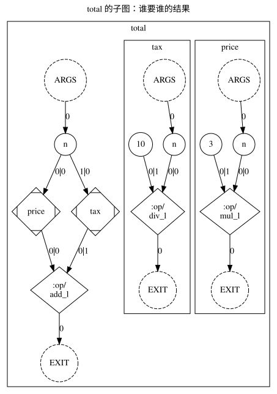

# 第 9 章 · 按依赖求值

[English](09_evaluation_by_dependency.en.md) | 中文 · [返回目录](tutorial.cn.md)

Camel 的执行模型只有一句话：**一个表达式会被求值，是因为有人需要它的结果**。这一章讲清楚这句话在图上
是什么样子，以及它跟"一条接一条执行"的差别。

## 谁需要谁的结果

[`examples/09_dependency.cml`](examples/09_dependency.cml)：

```cml
// Who needs whose result decides what runs, and what can run at the same time.
// Run: camel docs/tutorial/examples/09_dependency.cml
//      camel docs/tutorial/examples/09_dependency.cml std::gir

func price(n: int): int {
    return n * 3
}

func tax(n: int): int {
    return n / 10
}

// Neither call needs the other's result, and the addition needs both.
func total(n: int): int {
    return price(n) + tax(n)
}

func spare(n: int): int {
    return n + 1
}

// The result of `spare` is used by nothing, so the call is not part of what this function
// computes.
func total_with_a_spare(n: int): int {
    spare(n)
    return total(n)
}

func main(): int sync {
    println(total(10), total_with_a_spare(10))
    return 0
}
```

```bash
camel docs/tutorial/examples/09_dependency.cml
```

```text
31 31
```

## 图上的依赖

把图画出来（`camel docs/tutorial/examples/09_dependency.cml std::rgir > dep.dot`，再 `dot -Tsvg dep.dot -o dep.svg`；
本书里的图都由第 1 章那个脚本生成）。`total` 这个函数在图上是这样：



要逐个读属性（每条边是什么类型）的地方才贴节选的 DOT。下面是 `camel
docs/tutorial/examples/09_dependency.cml std::gir` 输出里 `total` 这一段：

<!-- camel-snippet: graph-dump: the text block is one excerpt of std::gir's DOT, not the program's stdout -->

```cml
// Who needs whose result decides what runs, and what can run at the same time.
// Run: camel docs/tutorial/examples/09_dependency.cml
//      camel docs/tutorial/examples/09_dependency.cml std::gir

func price(n: int): int {
    return n * 3
}

func tax(n: int): int {
    return n / 10
}

// Neither call needs the other's result, and the addition needs both.
func total(n: int): int {
    return price(n) + tax(n)
}

func spare(n: int): int {
    return n + 1
}

// The result of `spare` is used by nothing, so the call is not part of what this function
// computes.
func total_with_a_spare(n: int): int {
    spare(n)
    return total(n)
}

func main(): int sync {
    println(total(10), total_with_a_spare(10))
    return 0
}
```

```bash
camel docs/tutorial/examples/09_dependency.cml std::gir
```

```text
        subgraph cluster_F02 {
            label="total";
            subgraph cluster_F03 {
                label="price";
                F03 [label="ARGS", type="ARGS"];
                O03 [label="EXIT", type="EXIT"];
                N00 [label="n", type="PORT", param_name="n", param_kind="normal", param_index="0", value_type="int", origin=5, span="4:11-4:17", srcfile="docs/tutorial/examples/09_dependency.cml"];
                N01 [label="3", type="DATA", origin=227, span="6:15-6:16", srcfile="docs/tutorial/examples/09_dependency.cml", value_type="int"];
                N02 [label=":op/mul_l", type="OPER", origin=228, span="6:13-6:14", srcfile="docs/tutorial/examples/09_dependency.cml", value_type="int"];
                F03 -> N00 [label="0", type="NORM_PORT"];
                N02 -> O03 [label="0", type="EXIT"];
                N00 -> N02 [label="0|0", type="NORM"];
                N01 -> N02 [label="0|1", type="NORM"];
            }
            subgraph cluster_F04 {
                label="tax";
                F04 [label="ARGS", type="ARGS"];
                O04 [label="EXIT", type="EXIT"];
                N03 [label="n", type="PORT", param_name="n", param_kind="normal", param_index="0", value_type="int", origin=23, span="8:9-8:15", srcfile="docs/tutorial/examples/09_dependency.cml"];
                N04 [label="10", type="DATA", origin=231, span="10:15-10:17", srcfile="docs/tutorial/examples/09_dependency.cml", value_type="int"];
                N05 [label=":op/div_l", type="OPER", origin=232, span="10:13-10:14", srcfile="docs/tutorial/examples/09_dependency.cml", value_type="int"];
                F04 -> N03 [label="0", type="NORM_PORT"];
                N05 -> O04 [label="0", type="EXIT"];
                N03 -> N05 [label="0|0", type="NORM"];
                N04 -> N05 [label="0|1", type="NORM"];
            }
            F02 [label="ARGS", type="ARGS"];
            O02 [label="EXIT", type="EXIT"];
            N06 [label="n", type="PORT", param_name="n", param_kind="normal", param_index="0", value_type="int", origin=41, span="13:11-13:17", srcfile="docs/tutorial/examples/09_dependency.cml"];
            N07 [label="price", type="FUNC", origin=236, span="15:11-15:19", srcfile="docs/tutorial/examples/09_dependency.cml", value_type="int"];
            N08 [label="tax", type="FUNC", origin=238, span="15:22-15:28", srcfile="docs/tutorial/examples/09_dependency.cml", value_type="int"];
            N09 [label=":op/add_l", type="OPER", origin=239, span="15:20-15:21", srcfile="docs/tutorial/examples/09_dependency.cml", value_type="int"];
            F02 -> N06 [label="0", type="NORM_PORT"];
            N09 -> O02 [label="0", type="EXIT"];
            N06 -> N07 [label="0|0", type="NORM"];
            N06 -> N08 [label="1|0", type="NORM"];
            N07 -> N09 [label="0|0", type="NORM"];
            N08 -> N09 [label="0|1", type="NORM"];
        }
```

- `N07` 与 `N08` 是两次调用，边 `N07 -> N09`、`N08 -> N09` 说"加法要这两份结果"。
- **`N07` 和 `N08` 之间没有边。** 谁也等不到谁，所以它们可以同时算、可以换顺序——语言只要求结果对，
  没要求它们按书写的先后。这就是"按依赖求值"。
- `n`（`N06`）同时喂给两个调用，是因为两个调用都需要它，不是因为先来后到。

另一半在同一个文件里。`total_with_a_spare` 的图里只有一个调用节点：

```text
            N0E [label="total", type="FUNC", origin=248, span="26:11-26:19", srcfile="docs/tutorial/examples/09_dependency.cml", value_type="int"];
```

`spare(n)` 那一行没有留下任何节点：**没有任何东西需要它的结果，所以它不在要算的东西里**。

## 同步块：效应之间的同步边

`main` 是同步块，它的语句之间有那么一条边：

```text
        N10 -> N12 [label="0|0", type="CTRL"];
        N13 -> N15 [label="0|0", type="CTRL"];
```

**同步块在图上是效应之间的同步边**：`N10`（`total(10)`）到 `N12`（`total_with_a_spare(10)`）、
`N13`（`println`）到 `N15`（`GATE`）。写 `sync` 的意思就是"这里的顺序算数"：`println` 是效应，它必须在
`return` 之前发生。把 `sync` 去掉，这些 `CTRL` 边就没了，而 `println(total(10), ...)` 照样算得出来——
先算哪个由依赖决定，不由书写顺序决定（第 10 章）。

## 不按依赖求值的写法会怎样

`var` 与赋值是最常见的"顺序算数"的地方：写了 `x = 1` 再写 `x = 2`，图上是同一个位置的两次写入，顺序由
同步关系决定（[语言参考 4.4](../language/04_execution_model.md#44-var-与写入的顺序)）。Camel 不禁止顺序，
它只是不假装顺序是默认的：**要说顺序的地方才说顺序**。

## 这件事值在哪里

一条算得慢的链（这里是从 1 到 16000 每个数数 Collatz 步数）只要每个元素各算各的，就能直接换一个后端跑：
程序一个字都不用改。[`examples/parallel/parallel_map.cml`](../../examples/parallel/parallel_map.cml)：

```cml
// The same `map` runs sequentially or in parallel depending on the passes chosen on the
// command line; the program does not change and the results keep the order of the elements.
// Run: camel examples/parallel/parallel_map.cml
//      camel examples/parallel/parallel_map.cml std::prl

// Number of steps the Collatz sequence takes from `n` down to 1.
func collatz_steps(n: int, steps: int): int {
    return if n == 1 then steps
        else if n % 2 == 0 then collatz_steps(n / 2, steps + 1)
        else collatz_steps(3 * n + 1, steps + 1)
}

// The start value in [lo, hi) with the longest sequence, as (start, steps).
func longest_in(lo: int, hi: int): (int, int) {
    return lo..hi->reduce<
        (best: (int, int), n: int): (int, int) => longer(best, (n, collatz_steps(n, 0))),
        (lo, 0)
    >
}

func longer(a: (int, int), b: (int, int)): (int, int) {
    return if b.1 > a.1 then b else a
}

func main(): int sync {
    // Eight independent blocks of 2000 start values; each block is one element of the map.
    let block = 2000
    let results = 0..8->map<(i: int): (int, int) => longest_in(i * block + 1, (i + 1) * block + 1)>

    println(results)
    let best = results->reduce<longer, (1, 0)>
    println(format<8 * block, best.0, best.1>('longest up to {}: start {} takes {} steps'))
    return 0
}
```

```bash
camel examples/parallel/parallel_map.cml
```

```text
[(1161, 181), (3711, 237), (5567, 235), (6171, 261), (9257, 259), (10971, 267), (13255, 275), (14695, 270)]
longest up to 16000: start 13255 takes 275 steps
```

把命令行最后换成 `std::prl`（并行调度），输出一个字不差：图上的依赖没有变，变的只是谁先算。

## 在图上

- **依赖边是全部**：一条数据边就是"这边要那边的结果"。没有边的地方就没有顺序。
- **`CTRL` 边是同步块留下的**：同步块在图上是效应之间的同步边；它只出现在效应之间，不会把纯计算也串起来。
- 一个结果没有人需要，就没有节点；一个函数是一张子图，一次调用是图上的一个节点。

## 练习

把 `total(n)` 的两个调用改成互相依赖——例如 `price(tax(n))`——再打印一次图。现在 `price` 与 `tax` 之间
多了一条边，它们不能再同时算；两次调用的先后由依赖决定了。再看一遍输出：值还是 30，图变了。

参考答案 [`examples/09_exercise.cml`](examples/09_exercise.cml)：

```cml
// The answer to the exercise of chapter 9: one call now needs the other's result, so the graph
// has an edge between them and they no longer stand side by side.
// Run: camel docs/tutorial/examples/09_exercise.cml

func price(n: int): int {
    return n * 3
}

func tax(n: int): int {
    return n / 10
}

func total(n: int): int {
    return price(tax(n))
}

func main(): int sync {
    println(total(100))
    return 0
}
```

```bash
camel docs/tutorial/examples/09_exercise.cml
```

```text
30
```

## 参考

- [语言参考 4.2 按依赖求值](../language/04_execution_model.md#42-按依赖求值)
- [语言参考 4.3 `sync`](../language/04_execution_model.md#43-sync)
- [语言参考 4.4 `var` 与写入的顺序](../language/04_execution_model.md#44-var-与写入的顺序)