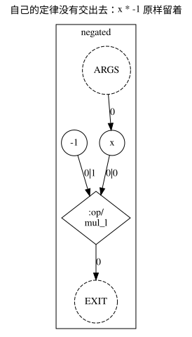
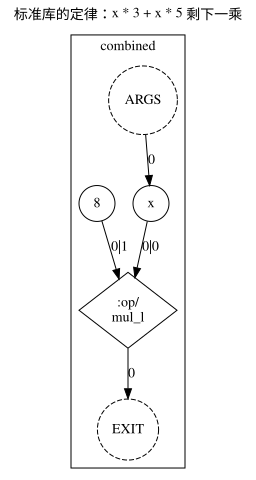
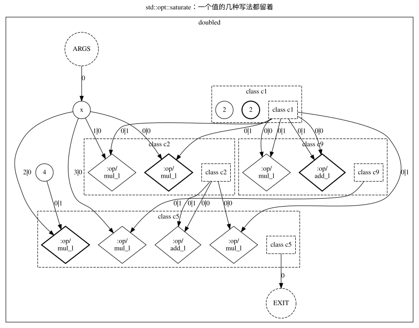

# Chapter 18 · Teaching the compiler a law

English | [中文](17_teaching_a_law.cn.md) · [Back to the contents](tutorial.en.md)

In chapter 1 the compiler turned `x * 2 + x * 2` into `x * 4` without changing the result. How dare it? Because
it holds a set of **laws**: "two multiplications by the same value are one multiplication". Those laws are
written in the standard library and they are finite; **the laws of your own field it does not know, and you have
to tell it**. This chapter writes one law, has the compiler check it, and then watches it being used on your
program.

## Writing a law

[`examples/17_rule.cml`](examples/17_rule.cml):

```cml
// The law of this program's arithmetic, written the way the compiler reads laws.
// Run: camel docs/tutorial/examples/17_rule.cml
module law

import { check } from rewrite

// Multiplying by -1 is negating. A `rule` names a pattern and the writing it may be replaced by.
// This one holds for every `int`, so it carries no condition; chapter 18 shows a law that needs one.
rule negate(x: int) { x * -1 => 0 - x }

func negated(x: int): int {
    return x * -1
}

// Laws the compiler's own library already knows: a sum of two scaled copies of one value is one
// scaled copy, so this is one multiplication.
func combined(x: int): int {
    return x * 3 + x * 5
}

// The same value written twice: `std::opt::saturate` keeps both writings in one class.
func doubled(x: int): int {
    return x * 2 + x * 2
}

func main(): int sync {
    // `check` draws random instances and compares the two sides of every rule it is given.
    println(check([negate], 100, 1))
    println(negated(7), combined(7), doubled(7))
    return 0
}
```

```bash
camel docs/tutorial/examples/17_rule.cml
```

```text
sampled negate: proposition equality, evidence samples 100, fired 8 of 8, coverage integer scalar int: (x * -1) = (0 - x)

-7 56 28
```

A `rule` has three parts: a **name**, a **pattern** (left of `=>`) and **what it may be replaced by** (right of
`=>`).

- This law holds for every `int`: `x * -1` and `0 - x` are the same value for any `x`, so it carries **no
  condition**. A law that may fire only where some knowledge holds is written with `when` — the section on `fact`
  below has the example that genuinely needs one.
- A parameter written `x: int` is "any expression here"; a parameter written `const c: int` is "a constant must
  be here". `x * c1 + x * c2 => x * (c1 + c2)` is how the standard library writes its combining law (the
  `c1 + c2` on the right is computed at compile time).
- A `rule` is a **value**, of type `Rule`. It can be passed to a function, put in an array, or handed to the
  rewriting engine.
- `check` draws instances for it at random, evaluates both sides, and compares. The line above says the law was
  tried 8 times and the two sides agreed all 8 times, and `(x * -1) = (0 - x)` is how it read the law.
- `check` decides by **sampling**: a counter-example proves the law wrong, but no counter-example only means none
  was found.
- The same file holds two more functions: `combined` is a shape the standard library's laws already know, and
  `doubled` writes one value twice.

## Handing the law to the optimizer

A `rule` is a **value** and does not enter any pass by itself: the rules written in a module are not collected
([language reference 9.4](../language/en/09_rules_and_facts.md)). To hand it to `std::opt`, the rule set is passed
**explicitly**: in Camel `f->std::opt<rules: [negate]>`, on the command line `std::opt rules=[law::negate]`.
**A law that was not handed over is not used**: the `negated` half of this file comes out of `std::opt`
**unchanged**, with `x * -1` still on the graph:

```bash
camel docs/tutorial/examples/17_rule.cml std::opt std::rgir > negated.dot
dot -Tsvg negated.dot -o negated.svg
```



The graph still has one `:op/mul_l` and one constant `-1`, and the result does not change (`negated(7)` is still
`-7`): that is the reading of "the law did not go in by itself".

**Hand it over and it is used.** `std::opt` has no `rules` parameter yet (writing it gives
`SemanticDiag::ParamArgumentUnknown`), so today there are two roads to make your own law take effect: write a pass
of your own and hand that to the command line, or let `check([negate], …)` draw random instances for it — the
`fired 8 of 8` above is the reading of "handed over explicitly". Once the `rules` parameter lands, the same file's
`x * -1` will be replaced by `0 - x` and that `:op/mul_l` will become an `:op/sub_l`: **a law is a value, and it
is used once it is handed over** — that is the one door through which knowledge reaches this pipeline.

## The compiler's own laws

`std::opt` holds the standard library's laws and nothing else (the one you wrote is not among them): `x * 3 + x * 5`
is a shape the library already knows. In the same file, under the same command, the `combined` half reads:



`x * 3 + x * 5` is down to one multiplication: `3 + 5` is folded into the constant `8` first, and then the two
multiplications become one. That law is not in your file; it is in the standard library, and `std::opt` uses it
because that library is what the pipeline holds.

## Equivalent graphs: several writings of one value

Optimization does not always decide at once which writing to keep. `std::opt::saturate` applies the standard
library's laws until nothing changes and **keeps every writing of a value**, leaving the choice to a later stage.
The `doubled` half of `camel docs/tutorial/examples/17_rule.cml std::opt::saturate std::rgir` reads:



Each dashed box is **one class of equivalent values** (a `class`): the nodes inside are different writings of the
same value, and the one marked `chosen="true"` is the one extraction would keep. So `x * 2 + x * 2` in `doubled`
still has `x * (2 + 2)`, `x * 4` and others — the laws have been applied, and the choice is left for later. That
way an optimization does not lose a possibility just because some law happened to fire first.

## Knowledge of a field: `fact`

A law says "these two writings are equal". A program also holds knowledge that is not an equation but a
**property of values**: a value is never negative, or lies between 0 and 1, or is a count of some range. Such
knowledge is declared with `fact`, a `rule`'s `when` reads it, and the rewrite happens only where the fact
holds.

[`examples/17_fact.cml`](examples/17_fact.cml):

```cml
// The knowledge of your field that is not an equation, handed to the compiler.
// Run: camel docs/tutorial/examples/17_fact.cml
module domain

import { check } from rewrite
import { abs } from math

// A `fact` says what the compiler may rely on for a value: a square is never negative. The match
// reads how the value was built; `join` says how the two writings of one value are merged.
fact nonnegative(v: int): bool match v {
    case const c => c >= 0
    case x * x   => true
    case _       => false
} join (lhs: bool, rhs: bool) => lhs | rhs

// The law holds only where the fact does: on a value that is never negative, `abs` changes nothing.
rule abs_of_nonnegative(x: int) when nonnegative(x) { abs(x) => x }

func squared(x: int): int {
    return abs(x * x)
}

func main(): int sync {
    // `check` samples the law together with its premise, so the fact decides where it may fire.
    println(check([abs_of_nonnegative], 100, 1))
    println(squared(-3))
    return 0
}
```

```bash
camel docs/tutorial/examples/17_fact.cml
```

```text
sampled abs_of_nonnegative: proposition equality, evidence samples 100, fired 8 of 8, coverage integer scalar int: abs(x) = x

9
```

The head of a `fact` says which type it gives which piece of knowledge for (here `int`'s `nonnegative`); the
body is a `match`, but what it reads is **how the value was built on the graph**: a square is never negative, a
constant can be decided at compile time, and everything else is `case _`. `join` says how the knowledge of two
writings of one value is merged (here `(lhs, rhs) => lhs | rhs`: either writing saying it is
non-negative is enough).

`fact` and `rule` together are the two doors through which "what is true in my field" reaches the compiler:
`rule` gives equalities, `fact` gives premises. Their full rules are in
[chapter 9 of the language reference](../language/en/09_rules_and_facts.md).

## On the graph

- **A `rule` is a small pattern on the graph**: the left of `=>` is a small pattern graph and the right is the
  graph that replaces it; applying a law means finding a match and swapping the subgraph. A rewritten node keeps
  the source span it had, so the graph still points back at your source.
- **After `saturate` one value can have several nodes**: they are grouped into equivalence classes, and `chosen`
  marks the one extraction would keep. The graph at that point is not "the program" but "the set of all
  equivalent writings".
- Whether a law comes from the standard library or from your file makes no difference at the graph level; the
  difference is only in what the pipeline holds.
- **A `fact` adds no node to the graph**: it is a pass's claim about the values on the graph, and it is what decides
  whether a law may be used.

## Exercise

Write a law of your own: `x * c1 + x * c2 => x * (c1 + c2)` (two multiplications of one value by constants become
one), have `check` give its verdict, and then answer one question: **why must the right-hand side be
`x * (c1 + c2)` and not `x * c1 + x * c2`?** (The first folds one multiplication at compile time; the second
only rewrites the expression.)

Answer [`examples/17_exercise.cml`](examples/17_exercise.cml):

```cml
// The answer to the exercise of chapter 18: a law written as a `rule`, and the verdict `check`
// gives it.
// Run: camel docs/tutorial/examples/17_exercise.cml
module exercise

import { check } from rewrite

rule fold_scales(x: int, const c1: int, const c2: int) { x * c1 + x * c2 => x * (c1 + c2) }

func main(): int sync {
    println(check([fold_scales], 100, 1))
    return 0
}
```

```bash
camel docs/tutorial/examples/17_exercise.cml
```

```text
sampled fold_scales: proposition equality, evidence samples 100, fired 8 of 8, coverage integer scalar int: ((x * c1) + (x * c2)) = (x * (c1 + c2))
```

## Reference

- [Language reference 4.7, Passes and pipelines](../language/en/04_execution_model.md#47-passes-and-pipelines)
- [Language reference 8.5, The complete grammar](../language/en/08_top_level_and_grammar.md#85-the-complete-grammar)
- [Design principles 9.3, Pass parameters](../design-principles.en.md#93-pass-parameters)